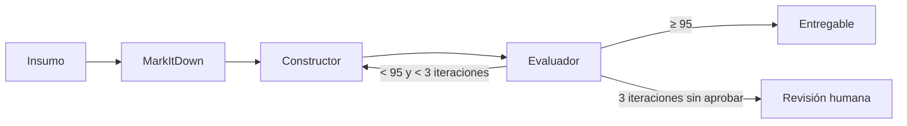

# Plan técnico: [NOMBRE DE LA FUNCIONALIDAD]

**Spec:** [`spec.md`](./spec.md)
**Rama:** `feature/[NNN-nombre-corto]`
**Fecha:** [AAAA-MM-DD]

> El plan describe **cómo** se va a cumplir la spec. Cada decisión debe poder rastrearse a un
> requerimiento (RF-XX) o historia (HU-X).

---

## 1. Resumen del enfoque

[Dos o tres párrafos: qué se va a construir y cómo encaja en V.I.D.A. (front, lógica, LiteLLM → VORKAN).]

## 2. Contexto técnico

| Aspecto | Decisión | Incógnitas |
|---|---|---|
| Lenguaje y versión | | |
| Dependencias nuevas | | |
| Almacenamiento | | |
| Pruebas | | |
| Modelos / proveedor | vía LiteLLM → VORKAN (Art. IV y V) | |

> Lo que no se sepa se marca como `[NECESITA ACLARACIÓN: ...]` y se resuelve en la Fase 0
> (`research.md`) antes de seguir. El plan no pasa a tareas con incógnitas abiertas.

## 3. Verificación contra la constitución

| Artículo | ¿Cumple? | Cómo |
|---|---|---|
| I — El formato definido manda | Sí / No / N.A. | |
| II — Cero información inventada | Sí / No / N.A. | |
| III — El RO decide | Sí / No / N.A. | |
| IV — Separación de capas | Sí / No / N.A. | |
| V — Independencia del modelo | Sí / No / N.A. | |
| VI — Eficiencia de tokens | Sí / No / N.A. | |
| VII — Constructor / Evaluador | Sí / No / N.A. | |
| VIII — Generalización | Sí / No / N.A. | |
| IX — Trazabilidad | Sí / No / N.A. | |
| X — Seguridad y datos | Sí / No / N.A. | |
| XI — Spec antes que código | Sí / No / N.A. | |
| XII — Idioma | Sí / No / N.A. | |

> Si algún artículo no se cumple, se justifica aquí y se escala antes de continuar.
> Esta tabla se vuelve a revisar al cerrar la Fase 1, con el diseño ya definido.

## 4. Componentes

| Componente | Tipo (agente / skill / script / config) | Responsabilidad | RF / HU que cubre |
|---|---|---|---|
| | | | |

## 5. Flujo

[Secuencia de pasos desde que entra el insumo hasta que sale el entregable. Puede incluir un diagrama Mermaid.]



## 6. Configuración

| Parámetro | Valor por defecto | Dónde se define |
|---|---|---|
| [ej. Modelo de una tarea] | [ej. minimax-m2.7] | [parámetro editable / variable de entorno] |
| | | |

## 7. Estructura de archivos que se crean o modifican

```
[ruta/archivo]   # propósito
```

## 8. Estrategia de validación

- **Caso de referencia:** [ej. Adapter Reverso]
- **Caso de generalización:** [ej. Adapter Confirmación de Recarga — PagoFácil]
- **Qué se compara:** [estructura, campos, PENDIENTE esperados, puntaje]

## 9. Migraciones de base de datos

[Si esta funcionalidad genera una migración, decirlo aquí. Recordar la convención de trabajo
en paralelo: **quien mezcla segundo regenera su migración** (ver `CONTRIBUTING.md`).]

## 10. Riesgos y decisiones abiertas

| Riesgo / decisión | Impacto | Mitigación |
|---|---|---|
| | | |

---

## Artefactos de diseño

Los genera `/speckit-plan` junto a este archivo, dentro de la carpeta de la spec. Todos en español.

| Fase | Archivo | Qué contiene | ¿Cuándo aplica? |
|---|---|---|---|
| 0 | `research.md` | Cada incógnita resuelta: decisión, razón y alternativas consideradas | Si la sección 2 tiene incógnitas |
| 1 | `data-model.md` | Entidades, atributos y relaciones | Si la funcionalidad maneja datos |
| 1 | `contracts/` | Contratos de las interfaces o endpoints | Si expone o consume una interfaz |
| 1 | `quickstart.md` | Cómo levantar y probar esto en local | Siempre |
