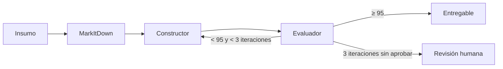

# Plan técnico: [NOMBRE DE LA FUNCIONALIDAD]

**Spec:** [`spec.md`](./spec.md)
**Rama:** `feature/[NNN-nombre-corto]`
**Fecha:** [AAAA-MM-DD]

> El plan describe **cómo** se va a cumplir la spec. Cada decisión debe poder rastrearse a un requerimiento (RF-XX) o historia (HU-X).

---

## 1. Resumen del enfoque

[Dos o tres párrafos: qué se va a construir y cómo encaja en V.I.D.A. (front, lógica, LiteLLM → VORKAN).]

## 2. Verificación contra la constitución

| Artículo | ¿Cumple? | Cómo |
|---|---|---|
| I — El formato definido manda | Sí / No / N.A. | |
| II — Cero información inventada | Sí / No / N.A. | |
| III — El RO decide | Sí / No / N.A. | |
| IV — Separación de capas | Sí / No / N.A. | |
| V — Independencia del modelo | Sí / No / N.A. | |
| VI — Eficiencia de tokens | Sí / No / N.A. | |
| VII — Constructor / Evaluador | Sí / No / N.A. | |
| VIII — Generalización | Sí / No / N.A. | |
| IX — Trazabilidad | Sí / No / N.A. | |
| X — Seguridad y datos | Sí / No / N.A. | |
| XII — Idioma | Sí / No / N.A. | |

> Si algún artículo no se cumple, se justifica aquí y se escala antes de continuar.

## 3. Componentes

| Componente | Tipo (agente / skill / script / config) | Responsabilidad | RF / HU que cubre |
|---|---|---|---|
| | | | |

## 4. Flujo

[Secuencia de pasos desde que entra el insumo hasta que sale el entregable. Puede incluir un diagrama Mermaid.]



## 5. Configuración

| Parámetro | Valor por defecto | Dónde se define |
|---|---|---|
| [ej. Modelo de una tarea] | [ej. minimax-m2.7] | [parámetro editable / variable de entorno] |
| | | |

## 6. Estructura de archivos que se crean o modifican

```
[ruta/archivo]   # propósito
```

## 7. Estrategia de validación

- **Caso de referencia:** [ej. Adapter Reverso]
- **Caso de generalización:** [ej. Adapter Confirmación de Recarga — PagoFácil]
- **Qué se compara:** [estructura, campos, PENDIENTE esperados, puntaje]

## 8. Riesgos y decisiones abiertas

| Riesgo / decisión | Impacto | Mitigación |
|---|---|---|
| | | |
