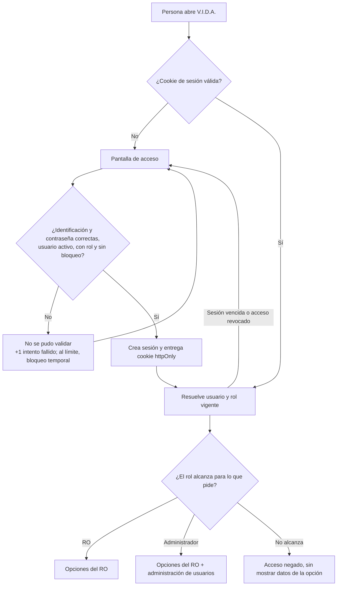

# Plan técnico: Acceso y roles

**Spec:** [`spec.md`](./spec.md)
**Rama:** `feature/001-acceso-y-roles`
**Fecha:** 2026-10-25

> El plan describe **cómo** se va a cumplir la spec. Cada decisión debe poder rastrearse a un requerimiento (RF-XX) o historia (HU-X).

---

## 1. Resumen del enfoque

Esta funcionalidad levanta las dos capas de V.I.D.A. y, sobre ellas, lo mínimo para que alguien entre: un **front en Next.js (TypeScript)** y un **backend en Python con FastAPI**, con **PostgreSQL** como base de datos. El front no decide nada sobre permisos: pregunta al backend quién es el usuario y con qué rol entró, y dibuja solo las opciones de ese rol (RF-04). La autorización real se verifica en el backend en cada petición (RF-05), de modo que ocultar una opción en la pantalla nunca es la única barrera. Ninguna credencial ni lógica de decisión vive en el front (Art. IV).

La sesión se maneja con **cookie de sesión `httpOnly` y estado en la base de datos**: la cookie solo lleva un identificador opaco y la validez se resuelve consultando la tabla de sesiones. Se elige esto sobre un token autocontenido porque la spec exige que revocar o eliminar un usuario le quite el acceso sin esperar a que algo expire (RF-15 y su caso borde) y que la duración de la sesión sea configuración (RF-07); con estado en base de datos, ambas cosas son una fila que se borra o un parámetro que se lee, no una reimplementación.

No hay nada de IA en esta funcionalidad: no se analiza información, no se genera documentación y no se llama a ningún modelo. Por eso no aparece LiteLLM ni VORKAN en el plan. Lo que sí queda establecido es dónde entrarán: toda la lógica futura de análisis y generación vive en el backend de Python, que es la capa que más adelante hablará con LiteLLM (Art. IV) con el modelo tomado de configuración (Art. V). El backend se escribe en Python, además, porque es el lenguaje de MarkItDown y de LiteLLM, las piezas que necesitarán las funcionalidades 004 y 005.

Siguiendo la regla de no adelantarse, aquí se crea **solo** lo que exige esta spec: usuarios, sesiones, acceso, visibilidad por rol, administración de usuarios y cambio de contraseña. No se crean carpetas, modelos ni pantallas para tipos de documentación, actividades, generación ni parámetros del sistema.

## 2. Verificación contra la constitución

| Artículo | ¿Cumple? | Cómo |
|---|---|---|
| I — El formato definido manda | N.A. | Esta funcionalidad no lee ni genera documentos y no toca ningún formato. |
| II — Cero información inventada | Sí | Ningún dato de acceso se deduce: sin rol asignado no hay rol por defecto y se niega el acceso (RF-06). El rol nunca se infiere del correo, del dominio ni de ningún otro dato. |
| III — El RO decide | N.A. | No hay insumos incompletos que preguntar: aplica desde la funcionalidad 004. Lo que sí se respeta es que cambiar la contraseña es decisión del usuario, no una imposición del sistema (RF-17, RF-21). |
| IV — Separación de capas | Sí | El front (Next.js) no contiene lógica de autorización ni credenciales: solo muestra lo que el backend le dice que el rol puede ver. Toda decisión y todo secreto viven en el backend (FastAPI). No hay acceso a modelos en esta funcionalidad. |
| V — Independencia del modelo | N.A. | No se usa ningún modelo. Cuando se usen, el backend es la única capa que los invoca y el modelo saldrá de configuración. |
| VI — Eficiencia de tokens | N.A. | No se envía nada a ningún modelo. |
| VII — Constructor / Evaluador | N.A. | No hay documento generado que evaluar. |
| VIII — Generalización | Sí | La validación no usa el caso de referencia (Adapter Reverso): se verifica con los cinco casos de acceso y las seis acciones de administración de la sección 8 de la spec, con usuarios ficticios (sección 7 de este plan). |
| IX — Trazabilidad | Parcial, por diseño | La trazabilidad de campos de documentos no aplica todavía. Cada decisión de acceso sí es atribuible al rol vigente del usuario, y el registro de usuario guarda cuándo se creó y cuándo cambió. **No se construye registro de auditoría**: la spec lo deja explícitamente fuera de alcance por decisión del responsable del proyecto. Si más adelante se requiere, se agrega sin rehacer lo de aquí. |
| X — Seguridad y datos | Sí | Solo usuarios autenticados (RF-01) y exactamente dos roles (RF-02). Las contraseñas se guardan con hash **Argon2id** y nunca en forma legible, para nadie (RF-19). Ningún secreto en el repositorio: todo por variables de entorno, con `.env.ejemplo` versionado y `.env` ignorado. El Administrador inicial se crea con un comando en la puesta en marcha, que toma la contraseña del entorno o la pide por consola, sin dejarla en código ni en el historial (RF-18). Los datos de prueba son ficticios. |
| XII — Idioma | Sí | Interfaz, mensajes de error, nombres de rutas, modelos, parámetros y documentación, en español. |

> Si algún artículo no se cumple, se justifica aquí y se escala antes de continuar.

**Nota sobre el Artículo IX:** se marca *parcial* y no *Sí* a propósito, para que quede visible que fue una decisión consciente del responsable del proyecto (aclaración del 2026-10-25) y no un olvido del plan.

## 3. Componentes

| Componente | Tipo (agente / skill / script / config) | Responsabilidad | RF / HU que cubre |
|---|---|---|---|
| `backend/app/configuracion.py` | config | Lee del entorno la duración de la sesión, la política de contraseñas, el bloqueo por intentos y la conexión a la base de datos. Ningún valor de estos fijo en el código. | RF-07, RF-23 |
| `backend/app/modelos/usuario.py` | script | Tabla de usuarios: identificación única, rol (`RO` / `ADMINISTRADOR`), hash de contraseña, estado del acceso (activo / revocado), intentos fallidos y bloqueo vigente. | RF-02, RF-03, RF-10, RF-12, RF-15, RF-22 |
| `backend/app/modelos/sesion.py` | script | Tabla de sesiones: identificador opaco, usuario, creación y expiración. Permite cortar el acceso al revocar. | RF-07, RF-15 |
| `backend/app/seguridad/contrasena.py` | script | Calcula y verifica el hash Argon2id, y valida la política vigente (longitud, lista de comunes, identificación contenida, distinta de la anterior). | RF-19, RF-20, HU-6 |
| `backend/app/datos/contrasenas-comunes.txt` | config | Lista de contraseñas de uso común que se rechazan. Datos públicos, ningún dato de cliente. | RF-20 |
| `backend/app/seguridad/sesiones.py` | script | Crea, valida y termina sesiones; aplica la expiración configurada y rechaza sesiones de usuarios revocados o eliminados. | RF-01, RF-07, RF-15 |
| `backend/app/seguridad/autorizacion.py` | script | Dependencia de FastAPI que resuelve el usuario y rol de cada petición y exige el rol requerido. Es el único lugar donde se decide si una petición pasa. | RF-01, RF-03, RF-05, RF-06 |
| `backend/app/rutas/acceso.py` | script | Entrar, cerrar sesión y consultar la sesión actual (identificación y rol vigente). Cuenta intentos fallidos y aplica el bloqueo temporal, con mensajes que no revelan si el usuario existe. | HU-1, HU-3, HU-4, RF-08, RF-09, RF-22 |
| `backend/app/rutas/usuarios.py` | script | Administración de usuarios, solo para el rol Administrador: listar, crear, cambiar rol, restablecer contraseña, revocar y eliminar. Impide dejar la plataforma sin Administrador activo. | HU-5, RF-11 a RF-16 |
| `backend/app/rutas/perfil.py` | script | Cambio de la propia contraseña acreditando la actual. | HU-6, RF-17 |
| `backend/scripts/crear_admin.py` | script | Comando de puesta en marcha que crea el Administrador inicial. Toma la contraseña del entorno o la pide por consola; nunca la escribe en el repositorio. | RF-18 |
| `backend/alembic/` | script | Migraciones de la base de datos, para que el esquema no se cree a mano. | RF-10 |
| `frontend/middleware.ts` | script | Deja pasar a la pantalla de acceso y redirige a ella cualquier ruta sin cookie de sesión, sin renderizar nada de la plataforma. | RF-01, HU-3 |
| `frontend/app/acceso/page.tsx` | script | Pantalla de identificación y mensajes de acceso negado. | HU-1, RF-09 |
| `frontend/app/(privado)/layout.tsx` | script | Capa autenticada: consulta la sesión actual en el backend, muestra identificación y rol, y arma el menú con las opciones del rol. | HU-2, HU-4, RF-04, RF-08 |
| `frontend/app/(privado)/inicio/page.tsx` | script | Pantalla de entrada tras identificarse, con las opciones del rol. | HU-2 |
| `frontend/app/(privado)/administracion/usuarios/page.tsx` | script | Pantalla de administración de usuarios, con las seis acciones. Visible solo para el Administrador, y protegida igual en el backend. | HU-5, RF-11 a RF-16 |
| `frontend/app/(privado)/perfil/contrasena/page.tsx` | script | Pantalla de cambio de la propia contraseña. | HU-6, RF-17 |
| `frontend/lib/api.ts` | script | Único punto desde donde el front llama al backend, con la cookie de sesión. Sin lógica de permisos. | Art. IV |
| `docker-compose.yml` | config | PostgreSQL para desarrollo, sin credenciales reales versionadas. | RF-10 |
| `.env.ejemplo` | config | Plantilla de variables de entorno, con valores de ejemplo y ningún secreto real. | Art. X.2 |

## 4. Flujo

Dos recorridos: entrar a la plataforma, y pedir cualquier cosa ya estando dentro. El segundo es el que garantiza que ocultar una opción no sea la única defensa.

**Entrar (HU-1, HU-3, RF-09, RF-22).** La persona envía identificación y contraseña desde la pantalla de acceso. El backend busca al usuario; si no existe, si está revocado, si está bloqueado o si la contraseña no coincide, responde siempre lo mismo: no se pudo validar. Si coincide y el usuario está activo y tiene rol, crea la sesión, devuelve la cookie `httpOnly` y reinicia el contador de intentos fallidos. Si falla, suma uno al contador y, al llegar al límite configurado, bloquea la cuenta por el tiempo configurado.

**Pedir algo estando dentro (HU-2, RF-01, RF-05).** Toda petición pasa por la misma dependencia de autorización: sin cookie válida, o con sesión vencida, revocada o sin rol, se responde como no autenticado y el front lleva a identificarse. Con sesión válida, se compara el rol vigente con el rol que exige la operación; si no alcanza, se niega sin devolver ningún dato de esa opción.



## 5. Configuración

| Parámetro | Valor por defecto | Dónde se define |
|---|---|---|
| Duración de la sesión | 480 minutos | variable de entorno `VIDA_SESION_MINUTOS` |
| Longitud mínima de contraseña | 12 | variable de entorno `VIDA_CONTRASENA_MIN` |
| Longitud máxima de contraseña | 64 | variable de entorno `VIDA_CONTRASENA_MAX` |
| Intentos fallidos antes del bloqueo | 5 | variable de entorno `VIDA_INTENTOS_MAX` |
| Duración del bloqueo temporal | 15 minutos | variable de entorno `VIDA_BLOQUEO_MINUTOS` |
| Lista de contraseñas comunes | `app/datos/contrasenas-comunes.txt` | variable de entorno `VIDA_CONTRASENAS_COMUNES` (ruta) |
| Conexión a PostgreSQL | sin valor por defecto | variable de entorno `VIDA_BD_URL` |
| Identificación del Administrador inicial | sin valor por defecto | variable de entorno `VIDA_ADMIN_INICIAL` (solo en la puesta en marcha) |
| Contraseña del Administrador inicial | sin valor por defecto | variable de entorno `VIDA_ADMIN_INICIAL_CONTRASENA`, o se pide por consola |
| Dirección del backend para el front | `http://localhost:8000` | variable de entorno `VIDA_API_URL` |

Ningún valor de esta tabla queda escrito en el código: todos se leen al arrancar (RF-23). Los parámetros sin valor por defecto hacen fallar el arranque si faltan, en vez de asumir algo.

## 6. Estructura de archivos que se crean o modifican

```
docker-compose.yml                                  # PostgreSQL para desarrollo
.env.ejemplo                                        # plantilla de variables, sin secretos
.gitignore                                          # ignora .env y artefactos de build

backend/
├── pyproject.toml                                  # dependencias del backend
├── alembic.ini                                     # configuración de migraciones
├── alembic/versions/                               # migración inicial: usuario y sesion
├── app/
│   ├── main.py                                     # arranque de FastAPI y registro de rutas
│   ├── configuracion.py                            # parámetros desde el entorno
│   ├── bd.py                                       # conexión y sesión de base de datos
│   ├── modelos/
│   │   ├── usuario.py                              # usuario, rol, estado, intentos, bloqueo
│   │   └── sesion.py                               # sesiones con expiración
│   ├── esquemas/
│   │   ├── acceso.py                               # entrada y salida de identificación
│   │   └── usuarios.py                             # entrada y salida de administración
│   ├── seguridad/
│   │   ├── contrasena.py                           # hash Argon2id y política
│   │   ├── sesiones.py                             # crear, validar y terminar sesiones
│   │   └── autorizacion.py                         # dependencia de rol por petición
│   ├── rutas/
│   │   ├── acceso.py                               # entrar, salir, sesión actual
│   │   ├── usuarios.py                             # administración de usuarios
│   │   └── perfil.py                               # cambio de propia contraseña
│   └── datos/contrasenas-comunes.txt               # lista pública de contraseñas rechazadas
├── scripts/crear_admin.py                          # Administrador inicial (puesta en marcha)
└── tests/
    ├── test_acceso.py                              # HU-1, HU-3, RF-09, RF-22
    ├── test_autorizacion.py                        # HU-2, RF-04, RF-05, RF-06
    ├── test_usuarios.py                            # HU-5, RF-11 a RF-16
    ├── test_contrasenas.py                         # HU-6, RF-17, RF-19, RF-20
    └── datos_ficticios.py                          # usuarios de prueba, todos ficticios

frontend/
├── package.json                                    # dependencias del front
├── middleware.ts                                   # sin sesión, no se renderiza nada privado
├── lib/api.ts                                      # único punto de llamada al backend
├── app/
│   ├── layout.tsx                                  # estructura e idioma (es)
│   ├── acceso/page.tsx                             # pantalla de identificación
│   └── (privado)/
│       ├── layout.tsx                              # sesión actual, identificación, rol y menú
│       ├── inicio/page.tsx                         # opciones del rol
│       ├── administracion/usuarios/page.tsx        # administración de usuarios
│       └── perfil/contrasena/page.tsx              # cambio de contraseña
└── e2e/visibilidad-por-rol.spec.ts                 # HU-2: lo que ve cada rol

README.md                                           # cómo levantar front, backend y base de datos
```

## 7. Estrategia de validación

- **Caso de referencia:** el recorrido del **RO**: entra, ve solo sus opciones, cambia su contraseña y no alcanza la administración de usuarios ni desde el menú ni por acceso directo.
- **Caso de generalización:** el recorrido del **Administrador** más los tres casos que no son un usuario normal: usuario autenticado **sin rol**, usuario con el acceso **revocado** y **persona sin sesión**. Ninguno de los cuatro tiene relación con el caso de referencia del proyecto (Adapter Reverso), con lo que el Artículo VIII queda cubierto con casos propios de esta funcionalidad.
- **Qué se compara:**
  - **Acceso:** que no exista ninguna ruta del backend que responda datos sin sesión válida, y ninguna pantalla que se renderice sin ella. Se verifica recorriendo la lista completa de rutas, no una muestra.
  - **Visibilidad por rol:** que el RO no vea ni alcance ninguna opción de administración, y que el Administrador vea las suyas y las del RO.
  - **Administración de usuarios:** las seis acciones, incluida la que debe fallar siempre (dejar la plataforma sin Administrador activo).
  - **Contraseñas:** que la política se aplique en los tres puntos donde se fija una (creación, cambio y restablecimiento), que ninguna respuesta ni registro muestre una contraseña, y que el bloqueo por intentos fallidos se active y se levante por tiempo.
  - **Mensajes:** que ninguna negación de acceso permita distinguir si el usuario existe, si está bloqueado o cuál dato falló.
- **Cómo:** `pytest` cubre el backend, que es donde vive cada decisión; una prueba de extremo a extremo con Playwright cubre lo que solo se ve en pantalla (menú por rol). Todos los usuarios de prueba son ficticios (Art. X.3).

## 8. Riesgos y decisiones abiertas

| Riesgo / decisión | Impacto | Mitigación |
|---|---|---|
| El plan fija el stack de toda la plataforma a partir de una funcionalidad que no usa IA. | Alto: lo heredan las funcionalidades 002 a 007. | Decisión tomada por el responsable del proyecto el 2026-10-25. El backend queda en Python, el lenguaje de MarkItDown y LiteLLM, que son las piezas de las 004 y 005. |
| Ocultar opciones en el front puede confundirse con seguridad. | Alto: un RO podría alcanzar datos de administración. | La autorización se decide solo en el backend (`autorizacion.py`); el front nunca es la barrera. Hay pruebas de acceso directo a rutas de administración con rol RO (RF-05). |
| Sin recuperación autónoma de contraseña, todo olvido pasa por el Administrador. | Medio: si no hay Administrador disponible, el usuario queda esperando. | Decisión de la spec. RF-16 garantiza que siempre haya al menos un Administrador activo. Si el volumen de olvidos molesta, se especifica aparte. |
| El bloqueo por intentos fallidos puede usarse para dejar a alguien afuera a propósito. | Medio. | El bloqueo es temporal y se levanta por tiempo, sin intervención; los valores son configuración (RF-22, RF-23). |
| La contraseña del Administrador inicial puede terminar en el historial del repositorio o en el de la consola. | Alto: violaría el Art. X.2. | El comando la toma del entorno o la pide por consola sin mostrarla; `.env` está ignorado y solo se versiona `.env.ejemplo`. La verificación del diff antes del PR incluye buscar credenciales. |
| **Decisión abierta:** el momento exacto en que un cambio de rol toma efecto sobre una sesión abierta. | Bajo. | Se resuelve al implementar: el rol se lee de la base de datos en cada petición, así que el cambio aplica de inmediato. Queda anotado aquí porque la spec lo dejó al plan. |
| **Decisión abierta:** retención y eliminación de datos de acceso. | Bajo para esta funcionalidad. | Pendiente abierto del Art. X.4 de la constitución. No bloquea: esta funcionalidad no guarda archivos de los RO. |
