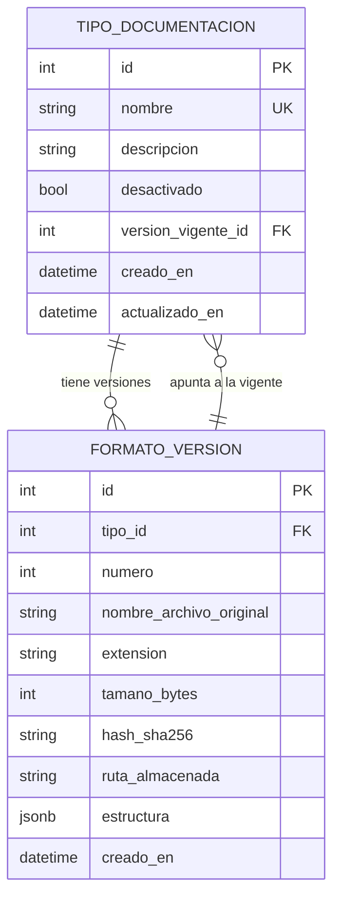
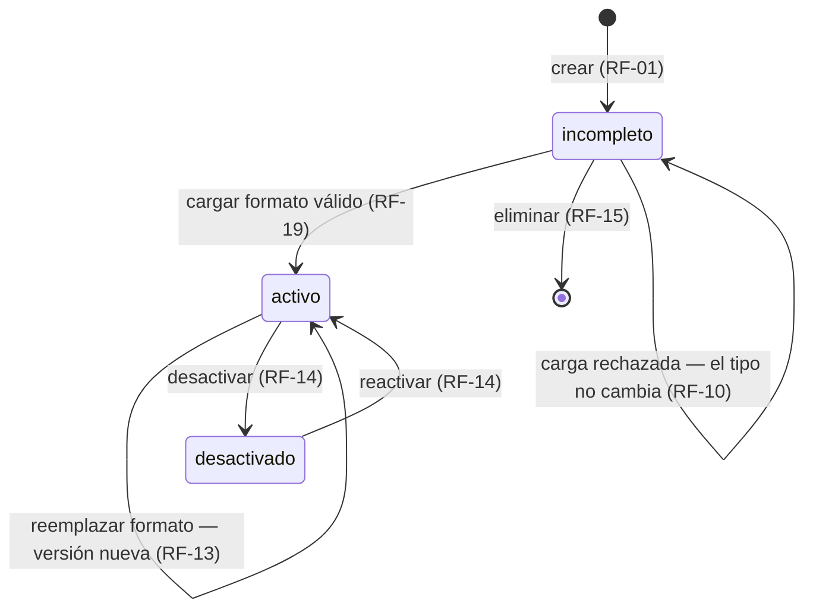

# Modelo de datos: Tipos de documentación

**Spec:** [`spec.md`](./spec.md) · **Plan:** [`plan.md`](./plan.md) · **Investigación:** [`research.md`](./research.md)
**Rama:** `feature/002-tipos-de-documentacion`
**Fecha:** 2026-11-03

Dos tablas nuevas. Nada de lo que viene abajo cambia las tablas de la 001 (`usuario`, `sesion`).

---

## Panorama



La doble relación es intencional: una versión pertenece a un tipo, y el tipo señala **cuál** de
sus versiones es la vigente. Esa referencia es lo que hace imposible que dos versiones se
declaren vigentes a la vez (decisión 7 de `research.md`).

## `tipo_documentacion`

| Columna | Tipo | Reglas | Requerimiento |
|---|---|---|---|
| `id` | `INTEGER` | Clave primaria | — |
| `nombre` | `VARCHAR(200)` | Obligatorio, **único**, no vacío tras quitar espacios | RF-02 |
| `descripcion` | `VARCHAR(1000)` | Puede faltar | RF-02 |
| `desactivado` | `BOOLEAN` | Obligatorio, por defecto `false` | RF-14 |
| `version_vigente_id` | `INTEGER` | Puede faltar → el tipo está **incompleto**. FK a `formato_version.id` | RF-19 |
| `creado_en` | `TIMESTAMPTZ` | `now()` del servidor | — |
| `actualizado_en` | `TIMESTAMPTZ` | `now()` del servidor, se actualiza al modificar | — |

### El estado no se guarda: se deriva

RF-03 pide distinguir tres estados. Se calculan, no se almacenan:

| Estado | Condición | Lo ve el RO |
|---|---|---|
| `incompleto` | `version_vigente_id IS NULL` | No (RF-16) |
| `activo` | `version_vigente_id IS NOT NULL` y `desactivado = false` | Sí |
| `desactivado` | `desactivado = true` | No (RF-16) |

**Por qué derivado y no una columna `estado`.** Con una columna existiría el estado imposible
«activo sin formato vigente», y habría que mantener dos datos sincronizados que dicen lo mismo.
Derivarlo hace que ese estado no pueda escribirse. `desactivado` sí se guarda, porque es una
decisión del Administrador y no se deduce de nada.

Un tipo desactivado que nunca tuvo formato sigue mostrándose como `desactivado`: la tabla está en
orden de precedencia.

### Unicidad del nombre

El índice único va sobre `lower(trim(nombre))`, no sobre `nombre`. Si no, «Adapter Reverso» y
«adapter reverso» convivirían, y para el Administrador son el mismo tipo. El nombre se **guarda
tal como lo escribió** (Art. II: no se normaliza el dato del usuario); lo que se normaliza es la
comparación.

## `formato_version`

| Columna | Tipo | Reglas | Requerimiento |
|---|---|---|---|
| `id` | `INTEGER` | Clave primaria | — |
| `tipo_id` | `INTEGER` | Obligatorio, FK a `tipo_documentacion.id`, `ON DELETE CASCADE` | RF-19 |
| `numero` | `INTEGER` | Obligatorio, empieza en 1, **único por tipo** | RF-21 |
| `nombre_archivo_original` | `VARCHAR(255)` | Obligatorio, tal como lo trajo el archivo | RF-20 |
| `extension` | `VARCHAR(5)` | `docx` o `xlsx` | RF-04 |
| `tamano_bytes` | `INTEGER` | Obligatorio | RF-18 |
| `hash_sha256` | `CHAR(64)` | Obligatorio | RF-20 |
| `ruta_almacenada` | `VARCHAR(500)` | Obligatorio, **relativa** a `VIDA_ALMACEN_FORMATOS` | RF-09, RF-20 |
| `estructura` | `JSONB` | Obligatoria | RF-05, RF-06, RF-20 |
| `creado_en` | `TIMESTAMPTZ` | `now()` del servidor. Es el «desde cuándo» del historial | RF-21 |

**`ruta_almacenada` es relativa** a la carpeta configurada, no absoluta. Una ruta absoluta
guardada en la base rompe el sistema en cuanto se mueve el almacén, se despliega en otra máquina
o se trabaja en un worktree con otra configuración.

**Las versiones no se borran ni se editan.** Solo se insertan. Es lo que sostiene el Art. IX:
una versión es el registro de qué estructura estaba vigente en un momento, y reescribirla
borraría la trazabilidad del documento que se generó con ella.

## La estructura reconocida (`estructura`)

Un documento JSON con una forma por cada clase de formato. Las listas están **en el orden del
archivo**, y ese orden es el dato (Art. I).

### Word

```json
{
  "clase": "word",
  "secciones": [
    { "nombre": "Contexto del servicio", "nivel": 1 },
    { "nombre": "Request",               "nivel": 2 },
    { "nombre": null,                    "nivel": 2 }
  ]
}
```

`"nombre": null` es un título sin texto en el archivo. Se registra como viene y **no** se le
inventa un nombre (RF-11). La posición en la lista lo identifica.

### Excel

```json
{
  "clase": "excel",
  "hojas": [
    {
      "nombre": "Request",
      "fila_de_encabezados": 3,
      "columnas": ["Campo", "Tipo", "Obligatorio", "Campo"]
    },
    { "nombre": "Response", "fila_de_encabezados": 1, "columnas": [] }
  ]
}
```

- `fila_de_encabezados` deja a la vista qué fila se tomó, para que el Administrador lo confirme
  (RF-08) y la decisión no quede escondida.
- `"Campo"` aparece dos veces porque así viene en el archivo: las columnas de nombre repetido se
  conservan todas, sin fusionarlas ni renumerarlas (sección 7 de la spec).
- `columnas: []` es una hoja sin encabezados. Es válida; lo que no es válido es un formato del
  que no se reconozca **nada** (ver abajo).

### La regla de «sin estructura reconocible»

Un formato se rechaza (RF-10) cuando, tras leerlo, la estructura queda vacía:

- Word: `secciones` vacía.
- Excel: ninguna hoja con al menos una columna.

Un Excel con hojas pero sin un solo encabezado no sirve para generar nada, así que cuenta como
sin estructura.

## Estados y transiciones de un tipo



Lo que **no** existe como transición: volver a `incompleto` desde `activo`. Una vez que un tipo
tiene una versión vigente, no se le puede quitar. Para sacarlo de circulación está desactivarlo.

**Eliminar** solo se permite en `incompleto`, que es la lectura literal de RF-15 («tipos que
nunca han sido usados»): un tipo sin formato vigente nunca pudo ser elegido por un RO. El
`ON DELETE CASCADE` cubre el caso de un tipo con versiones rechazadas; si llegara a tener
versiones, se van con él.

> Cuando la 003 introduzca la actividad, «en uso» pasará a significar «tiene actividades». Esta
> funcionalidad no conoce la actividad y no se adelanta a definirla.

## Migración

Una sola migración de Alembic, con las dos tablas y la clave foránea cruzada.

**El orden importa:** `tipo_documentacion.version_vigente_id` apunta a `formato_version`, y
`formato_version.tipo_id` apunta de vuelta. Se crean las dos tablas y la segunda FK se agrega
después con `ALTER TABLE`, o se declara como `use_alter=True`. Declararlas juntas en el `CREATE`
falla porque cada tabla necesita que la otra exista.

`version_vigente_id` lleva `ON DELETE SET NULL` y `use_alter=True`; `tipo_id` lleva
`ON DELETE CASCADE`.

> **Convención de trabajo en paralelo:** si la 007 entra a `main` antes que esta rama, hay que
> regenerar esta migración sobre la cabeza nueva. Quien mezcla segundo regenera
> ([`CONTRIBUTING.md`](../../CONTRIBUTING.md#trabajo-en-paralelo)).
