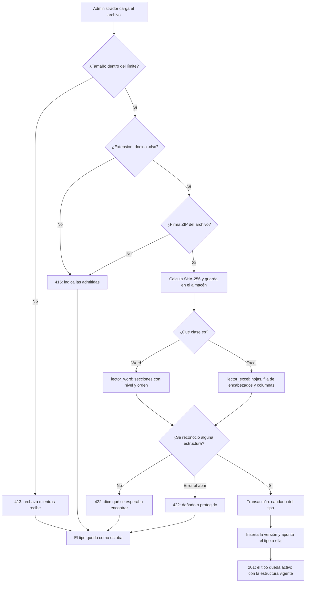

# Plan técnico: Tipos de documentación

**Spec:** [`spec.md`](./spec.md)
**Rama:** `feature/002-tipos-de-documentacion`
**Fecha:** 2026-11-03

> El plan describe **cómo** se va a cumplir la spec. Cada decisión debe poder rastrearse a un
> requerimiento (RF-XX) o historia (HU-X).

**Artefactos de diseño:** [`research.md`](./research.md) · [`data-model.md`](./data-model.md) ·
[`contracts/api-tipos-de-documentacion.md`](./contracts/api-tipos-de-documentacion.md) ·
[`quickstart.md`](./quickstart.md)

---

## 1. Resumen del enfoque

Se agregan dos tablas (`tipo_documentacion` y `formato_version`), un enrutador de administración
y uno de consulta para los RO en el backend, y dos pantallas en el front. Todo sigue las
convenciones que dejó la 001: la lógica y las credenciales viven en el backend (Art. IV), la
autorización se resuelve con la dependencia `exigir_administrador` aplicada al enrutador
completo, y el front llama al backend únicamente por `frontend/lib/api.ts`.

El corazón de la funcionalidad es el **reconocimiento del formato**, y la decisión que lo define
es que **no interviene ningún modelo**: la estructura de un `.docx` se lee con `python-docx` y la
de un `.xlsx` con `openpyxl`, de forma determinista. Un modelo podría normalizar un título o
inventar un nombre de columna, que es exactamente lo que los artículos I y II prohíben; una
librería que recorre párrafos y hojas no puede hacerlo. La consecuencia es que esta funcionalidad
**no toca LiteLLM ni VORKAN** (ver la decisión 1 de `research.md`).

La segunda decisión que organiza el diseño es el **versionado del formato** (RF-19 a RF-21),
resuelto como aclaración el 2026-11-03. Cada carga produce una versión inmutable con su archivo
y su estructura; el tipo apunta a cuál es la vigente. Eso es lo que permite que un documento
generado el mes pasado se siga explicando contra el formato que lo produjo, que es lo que exige
el Art. IX.

## 2. Contexto técnico

| Aspecto | Decisión | Incógnitas |
|---|---|---|
| Lenguaje y versión | Python ≥ 3.12 (backend), TypeScript con Next.js (front), tal como la 001 | — |
| Dependencias nuevas | `python-docx>=1.1` y `openpyxl>=3.1`. Ninguna más: no entra `pandas`, ni `markitdown`, ni cliente de LiteLLM | — |
| Almacenamiento | PostgreSQL para los datos y la estructura reconocida (`JSONB`); sistema de archivos para el archivo original, en carpeta configurable | — |
| Pruebas | `pytest` en el backend, Playwright en el front. Los tres formatos de prueba se generan con datos ficticios | — |
| Tiempo de respuesta | Techo de **30 s** para la carga completa, **síncrona** en la misma petición. Sin procesamiento en segundo plano (aclaración del 2026-11-04) | — |
| Modelos / proveedor | **No aplica.** Esta funcionalidad no llama a ningún modelo (decisión 1 de `research.md`) | — |

No quedan incógnitas abiertas: las diez que había se resolvieron en la Fase 0.

## 3. Verificación contra la constitución

| Artículo | ¿Cumple? | Cómo |
|---|---|---|
| I — El formato definido manda | Sí | Una sección es un párrafo con estilo de título y nada más; los encabezados de una hoja salen de su primera fila con contenido (RF-05a, RF-05b). La estructura se lee de forma determinista y se guarda como listas ordenadas en `JSONB`, sin normalizar nada. Las secciones y columnas de nombre repetido se conservan todas; las sin nombre se guardan como `null` sin inventarles uno. La prueba de reconocimiento compara contra la estructura exacta del archivo generado, así que el cumplimiento es verificable y no una opinión |
| II — Cero información inventada | Sí | Ningún modelo interviene. Lo que no está en el archivo no aparece en la estructura. Un formato del que no se reconoce nada se rechaza (RF-10) en vez de completarse |
| III — El RO decide | N.A. | Esta funcionalidad no le pide información al RO: solo le ofrece la lista de tipos activos |
| IV — Separación de capas | Sí | Toda la lectura de archivos, la validación y la autorización están en el backend. El front no tiene credenciales ni decide permisos: oculta opciones por comodidad, y la barrera es la dependencia del enrutador |
| V — Independencia del modelo | N.A. | No hay ninguna tarea de modelo en esta funcionalidad. El primer uso llega en la 004 |
| VI — Eficiencia de tokens | Sí | Ningún archivo se envía a un modelo, ni completo ni en parte. El formato se analiza **una sola vez** al cargarlo y la estructura se lee después de la base de datos: reabrir el detalle de un tipo no reprocesa el archivo (RF-07) |
| VII — Constructor / Evaluador | N.A. | No se genera ningún documento aquí, así que no hay nada que evaluar. Aplica desde la 005 |
| VIII — Generalización | Sí | Ningún nombre de sección queda escrito en el código: la plataforma reconoce lo que traiga el archivo (RF-17). Se valida con tres formatos, dos de ellos ajenos al caso de referencia, uno Word y uno Excel |
| IX — Trazabilidad | Sí | El versionado es lo que lo sostiene: cada versión guarda su archivo, su hash y su estructura, y no se edita ni se borra nunca. Las funcionalidades posteriores pueden atar un documento a la versión con la que se produjo (RF-20) |
| X — Seguridad y datos | Sí | Solo el Administrador administra tipos, por dependencia del enrutador. Los archivos se guardan bajo `uploads/`, ya excluido en `.gitignore`, y ninguna credencial entra al código. Los tres formatos de prueba son ficticios y **generados**: el formato real del cliente no entra al repositorio (X.3) |
| XI — Spec antes que código | Sí | Este plan sale de una spec aprobada y sin aclaraciones abiertas. No se escribe código antes de `tasks.md` |
| XII — Idioma | Sí | Código, mensajes de error, pantallas y estos artefactos, en español |

**X.4 y X.5 siguen pendientes en la constitución.** El X.4 —retención y eliminación de los
archivos cargados— ahora también alcanza a las versiones anteriores de un formato, que esta
funcionalidad conserva indefinidamente a propósito. No bloquea la implementación, pero conviene
resolverlo antes de que la plataforma acumule formatos de verdad, y se resuelve enmendando la
constitución, no aquí.

Esta tabla se vuelve a revisar al cerrar la Fase 1. **Revisada:** el diseño no introdujo ninguna
desviación respecto a lo anterior.

## 4. Componentes

| Componente | Tipo | Responsabilidad | RF / HU que cubre |
|---|---|---|---|
| `backend/app/modelos/tipo_documentacion.py` | Modelo | `TipoDocumentacion` y `FormatoVersion`, con el estado derivado | RF-02, RF-03, RF-19 |
| `backend/app/esquemas/tipos_de_documentacion.py` | Esquemas | Entradas y salidas de la API, con las validaciones de nombre | RF-02, RF-12 |
| `backend/app/formatos/lector_word.py` | Lógica | Lee las secciones de un `.docx` con su nivel y su orden | RF-05, RF-06, RF-11 |
| `backend/app/formatos/lector_excel.py` | Lógica | Lee hojas, fila de encabezados y columnas de un `.xlsx` | RF-05, RF-06, RF-11 |
| `backend/app/formatos/reconocimiento.py` | Lógica | Puerta única: valida tamaño, extensión y firma, elige el lector y decide si la estructura es reconocible | RF-04, RF-10, RF-18 |
| `backend/app/formatos/almacen.py` | Lógica | Escribe y lee el archivo en la carpeta configurada, calcula el hash y encapsula la ruta | RF-09, RF-20 |
| `backend/app/rutas/tipos_de_documentacion.py` | Rutas | Administración de tipos y carga de formatos. Exige Administrador en el enrutador | RF-01, RF-12 a RF-15, RF-21 |
| `backend/app/rutas/tipos_disponibles.py` | Rutas | Lista de tipos activos para los RO. Solo exige sesión | RF-16 |
| `backend/app/configuracion.py` | Config | Tres parámetros nuevos: carpeta del almacén, tamaño máximo y extensiones | RF-18 |
| `backend/alembic/versions/*_tipos_de_documentacion.py` | Migración | Las dos tablas y la clave foránea cruzada | RF-02, RF-19 |
| `backend/scripts/generar_formatos_de_prueba.py` | Script | Genera los tres formatos ficticios y la estructura esperada de cada uno | Art. VIII, Art. X.3 |
| `frontend/app/(privado)/administracion/tipos-de-documentacion/` | Pantallas | Listado y detalle con la estructura y el historial | HU-1 a HU-4 |
| `frontend/lib/api.ts` | Cliente | Se extiende para aceptar `FormData` en la carga del archivo | HU-2 |
| `frontend/app/componentes/menu-por-rol.tsx` | Componente | La opción nueva en el menú del Administrador | HU-1 |

**Por qué `app/formatos/` es un paquete aparte** y no vive dentro de las rutas: el reconocimiento
es la única parte de esta funcionalidad que las siguientes van a reutilizar —la 004 y la 005
trabajan sobre la estructura, y la 006 sobre el archivo—. Separarlo también hace que se pueda
probar sin levantar la API.

## 5. Flujo

La carga de un formato, que es donde está todo lo que importa:



En los cuatro rechazos el tipo conserva su versión vigente, o sigue incompleto (RF-10). El
archivo se escribe **antes** de abrir la transacción, para que dentro de ella no haya entrada ni
salida de disco; si la transacción falla, sobra un archivo que nadie referencia, que es el lado
correcto en el que fallar.

## 6. Configuración

| Parámetro | Valor por defecto | Dónde se define |
|---|---|---|
| `VIDA_ALMACEN_FORMATOS` | `uploads/formatos` | Variable de entorno, relativa a la raíz del repositorio |
| `VIDA_FORMATO_MB_MAX` | `25` | Variable de entorno (RF-18) |
| `VIDA_FORMATO_EXTENSIONES` | `docx,xlsx` | Variable de entorno (RF-18) |

Las tres tienen valor por defecto, así que un `.env` de la 001 sigue funcionando sin tocarlo.
Las tres se agregan a `.env.ejemplo`, que es uno de los archivos que todas las ramas tocan.

## 7. Estructura de archivos que se crean o modifican

```
backend/
├── app/
│   ├── configuracion.py                      # MODIFICA: tres parámetros nuevos
│   ├── main.py                               # MODIFICA: registra los dos enrutadores
│   ├── formatos/                             # NUEVO paquete
│   │   ├── __init__.py
│   │   ├── reconocimiento.py                 # puerta única: valida y despacha
│   │   ├── lector_word.py
│   │   ├── lector_excel.py
│   │   └── almacen.py                        # archivo en disco, hash y ruta
│   ├── modelos/
│   │   ├── __init__.py                       # MODIFICA: importa los modelos nuevos
│   │   └── tipo_documentacion.py             # NUEVO
│   ├── esquemas/
│   │   └── tipos_de_documentacion.py         # NUEVO
│   └── rutas/
│       ├── tipos_de_documentacion.py         # NUEVO: administración
│       └── tipos_disponibles.py              # NUEVO: consulta de los RO
├── alembic/versions/
│   └── xxxx_tipos_de_documentacion.py        # NUEVO
├── scripts/
│   └── generar_formatos_de_prueba.py         # NUEVO
├── tests/
│   ├── test_tipos_de_documentacion.py        # NUEVO
│   ├── test_reconocimiento_de_formato.py     # NUEVO
│   └── test_versiones_de_formato.py          # NUEVO
└── pyproject.toml                            # MODIFICA: python-docx y openpyxl

frontend/
├── app/(privado)/administracion/tipos-de-documentacion/
│   ├── page.tsx                              # NUEVO: listado
│   └── [id]/page.tsx                         # NUEVO: detalle, estructura e historial
├── app/componentes/menu-por-rol.tsx          # MODIFICA: la opción nueva
├── lib/api.ts                                # MODIFICA: acepta FormData
└── e2e/tipos-de-documentacion.spec.ts        # NUEVO

.env.ejemplo                                  # MODIFICA: las tres variables
.specify/memory/mapa-funcionalidades.md       # MODIFICA: estado de la 002 al cerrar
```

## 8. Estrategia de validación

- **Caso de referencia:** Word con la estructura del Adapter Reverso y contenido ficticio.
- **Casos de generalización:** un Word de otra forma (jerarquía distinta, títulos repetidos, uno
  sin nombre) y un Excel (varias hojas, encabezados fuera de la fila 1, columnas repetidas).
- **Qué se compara:** la estructura reconocida contra la que el script generador sabe que
  escribió —nombres, cantidad, orden y nivel—; los cuatro rechazos con su código y su mensaje; y
  que el tipo quede intacto tras cada rechazo.

Los tres archivos se **generan**, no se cometen: el formato real de un cliente no puede entrar al
repositorio (Art. X.3), y generar deja la estructura esperada escrita al lado del código que
produce el archivo, en vez de contra un valor mágico.

El recorrido manual completo, historia por historia, está en [`quickstart.md`](./quickstart.md).

## 9. Migraciones de base de datos

Una sola migración, con las dos tablas. La clave foránea de `tipo_documentacion.version_vigente_id`
hacia `formato_version` es cruzada —cada tabla referencia a la otra— así que se declara con
`use_alter=True` para que Alembic la agregue con un `ALTER TABLE` después de crear las dos tablas.

> **Convención de trabajo en paralelo:** la 007 es la otra funcionalidad que puede avanzar hoy, y
> también va a generar migración. **Quien mezcla segundo regenera la suya** sobre la cabeza nueva
> ([`CONTRIBUTING.md`](../../CONTRIBUTING.md#trabajo-en-paralelo)). Esta migración no toca las
> tablas de la 001, así que el único conflicto esperable es el de las dos cabezas.

## 10. Riesgos y decisiones abiertas

| Riesgo / decisión | Impacto | Mitigación |
|---|---|---|
| Un Word del área marca sus secciones con negrita o tamaño de letra, no con estilos de título | El reconocimiento no encuentra nada y el formato se rechaza, aunque para una persona «tenga secciones» | Es el comportamiento correcto por el Art. II: rechazar e informar antes que adivinar. El mensaje del 422 dice qué se esperaba, para que el Administrador aplique estilos y recargue. **Conviene validar esto temprano con un formato real del área**, porque si es lo habitual, cambia la conversación |
| La base y el disco se desincronizan: la versión existe y el archivo no | La 006 no podría generar el documento de ese tipo | El hash permite detectarlo. La ruta está encapsulada en `almacen.py`, así que pasar a `BYTEA` más adelante es un cambio local (decisión 6 de `research.md`) |
| Versiones que se acumulan sin límite | Crecimiento del disco con archivos que nadie consulta | Es deliberado: el Art. IX lo exige. La limpieza depende del pendiente X.4 de la constitución |
| Un `.xlsx` de 25 MB con muchas hojas se acerca al techo de 30 s | La carga se sentiría lenta, y pasar de 30 s incumpliría un criterio medible | `openpyxl` en modo solo lectura y el análisis una sola vez acotan el costo. La aclaración del 2026-11-04 cerró la arquitectura: **síncrona siempre**, sin proceso en segundo plano. Una tarea de la fase de validación mide el caso de 25 MB contra el techo, de modo que si no alcanza se sepa antes de cerrar la funcionalidad y no en producción |
| `pedirApi` hoy serializa a JSON siempre | La carga del archivo no funcionaría | Se extiende para aceptar `FormData` y, en ese caso, no fijar `Content-Type`: el navegador debe poner el suyo con el delimitador. Es aditivo y no altera las llamadas existentes |
