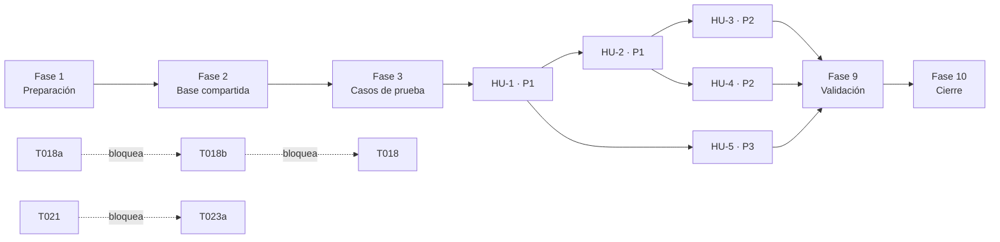

# Tareas: Tipos de documentación

**Spec:** [`spec.md`](./spec.md) · **Plan:** [`plan.md`](./plan.md)
**Rama:** `feature/002-tipos-de-documentacion`
**Insumos:** [`research.md`](./research.md), [`data-model.md`](./data-model.md),
[`contracts/api-tipos-de-documentacion.md`](./contracts/api-tipos-de-documentacion.md),
[`quickstart.md`](./quickstart.md), [`checklists/requisitos.md`](./checklists/requisitos.md)

> **Reglas**
>
> - Cada tarea es pequeña, verificable y tiene un criterio de terminado.
> - `[P]` indica que la tarea puede hacerse en paralelo con otras `[P]` de la misma fase.
> - `[HU-N]` indica a qué historia de usuario pertenece la tarea.
> - Se marca `[x]` solo cuando el criterio de terminado se cumple.
> - Un commit por tarea, con el ID en el mensaje: `T003: descripción`.
> - **Las pruebas no son opcionales en este proyecto.** El Art. VIII exige validar cada
>   capacidad con al menos un caso distinto al de referencia.
>
> **Organización:** las tareas se agrupan por historia de usuario, en orden de prioridad. Las
> fases 1 a 3 son compartidas y bloquean a todas las historias.

**Formato:** `[ID] [P] [HU-N] descripción`

**Prioridad de las historias:** HU-1 y HU-2 son **P1** y juntas forman el MVP —un tipo con su
formato reconocido—. HU-3 y HU-4 son **P2**. HU-5 es **P3**: es la más pequeña y la que menos
riesgo tiene, pero sin ella la 003 no tiene de dónde partir.

---

## Fase 1 — Preparación

**Propósito:** cerrar los dos puntos que pueden hacer que todo lo demás esté mal planteado, y
dejar las dependencias y la configuración listas.

- [ ] **T001** [P] Averiguar, abriendo **un formato Word real del área**, cómo marca sus secciones
  - Terminado cuando: está escrito en [`research.md`](./research.md), bajo la decisión 2, qué se encontró: si usa estilos de título, si usa negrita o tamaño de letra, o si mezcla
  - **Ya no bloquea nada**, y esa es la diferencia que trajo la aclaración del 2026-11-04: un formato sin estilos de título ya no se rechaza, lo atiende el respaldo con IA (RF-05c). Lo que esta tarea responde ahora es **cuál de los dos caminos va a ser el habitual**, que es lo que dice cuánto va a costar la funcionalidad en tokens y en esperas
  - Cubre: RF-05a, RF-05c, Art. II

- [x] **T002** Resolver en `spec.md` los cuatro vacíos de la checklist que bloquean la implementación
  - Terminado cuando: la spec responde (a) cuáles son los «equivalentes en otros idiomas» de `Título 1`…`Título 9` que se reconocen —CHK008—, (b) dónde se miden los 30 s: proceso en el servidor o punta a punta —CHK019—, (c) la regla de un nombre válido y si la comparación ignora mayúsculas y acentos —CHK011, CHK012— y (d) la longitud máxima del nombre y la descripción —CHK001—
  - Terminado cuando: cada respuesta queda escrita en la spec como requerimiento, no como nota al margen
  - El **marcado** de los ítems CHK001, CHK008, CHK011, CHK012 y CHK019 no es parte de esta tarea: lo hace quien revise, en T039 (Art. VII)
  - Cubre: RF-02, RF-02a, RF-05a
  - **Resuelta el 2026-11-04.** (a) El estilo de título se reconoce por la marca interna del archivo, igual en cualquier idioma, así que no hace falta ninguna lista de equivalentes; (b) los 30 s se miden punta a punta; (c) y (d) quedaron en RF-02 y RF-02a. La respuesta a (a) además abrió el respaldo con IA, que es el cambio de alcance de esta pasada

- [x] **T003** [P] Agregar `python-docx>=1.1` y `openpyxl>=3.1` a `backend/pyproject.toml`
  - Terminado cuando: `.venv/Scripts/python -m pip install -e ".[dev]"` instala las dos y `python -c "import docx, openpyxl"` no falla
  - Cubre: decisión 10 de `research.md`

- [x] **T004** [P] Agregar los tres parámetros nuevos a `backend/app/configuracion.py` y a `.env.ejemplo`
  - Terminado cuando: existen `almacen_formatos` (por defecto `uploads/formatos`), `formato_mb_max` (por defecto `25`) y `formato_extensiones` (por defecto `docx,xlsx`), con una propiedad que resuelve la ruta absoluta del almacén como ya lo hace `ruta_contrasenas_comunes`
  - Terminado cuando: un `.env` de la 001, sin esas variables, sigue arrancando el backend
  - Cubre: RF-18
  - Ojo: `.env.ejemplo` es uno de los archivos que todas las ramas tocan; al resolver el conflicto se conservan las dos partes

- [x] **T004a** Agregar los cuatro parámetros del respaldo con IA y subir `httpx` a dependencia de ejecución
  - Terminado cuando: existen `ia_respaldo` (por defecto `1`), `litellm_url` (por defecto `http://localhost:4000`), `litellm_api_key` (**sin** valor por defecto) y `modelo_reconocimiento` (por defecto `reconocimiento-de-formato`), con las cuatro en `.env.ejemplo` y la credencial **vacía** (Art. X.2)
  - Terminado cuando: `httpx>=0.28` pasa de `[project.optional-dependencies].dev` a `dependencies`, porque ahora el backend lo necesita en ejecución y no solo para probar
  - Terminado cuando: un `.env` sin ninguna de las cuatro arranca el backend, y sin credencial el respaldo queda indisponible sin tumbar nada
  - Terminado cuando: `VIDA_MODELO_RECONOCIMIENTO` nombra una **tarea** de LiteLLM, no un modelo concreto: ningún nombre de modelo queda en el código ni en `.env.ejemplo` (Art. V)
  - Cubre: RF-05c, Art. V, Art. X.2

## Fase 2 — Base compartida (bloquea a todas las historias)

**Propósito:** el esquema, los modelos y el almacén de archivos. Ninguna historia puede empezar
antes de cerrar esta fase.

- [x] **T005** Crear `backend/app/modelos/tipo_documentacion.py` con `TipoDocumentacion` y `FormatoVersion`
  - Terminado cuando: `TipoDocumentacion` tiene `nombre VARCHAR(200)` obligatorio y único, `descripcion VARCHAR(1000)` opcional, `desactivado BOOLEAN` obligatorio por defecto `false`, `version_vigente_id` opcional con FK a `formato_version.id`, y `creado_en` / `actualizado_en` con `server_default=func.now()` como en `Usuario`
  - Terminado cuando: `FormatoVersion` tiene `tipo_id` obligatorio con FK y `ON DELETE CASCADE`, `numero INTEGER` obligatorio y **único por tipo**, `nombre_archivo_original VARCHAR(255)`, `extension VARCHAR(5)`, `tamano_bytes INTEGER`, `hash_sha256 CHAR(64)`, `ruta_almacenada VARCHAR(500)` **relativa** al almacén, `estructura JSONB` obligatoria y `creado_en`
  - Terminado cuando: el estado (`incompleto` / `activo` / `desactivado`) es una **propiedad derivada**, no una columna, con la precedencia de [`data-model.md`](./data-model.md)
  - Cubre: RF-02, RF-03, RF-19, RF-20

- [x] **T006** Crear la migración de Alembic de las dos tablas
  - Terminado cuando: `alembic upgrade head` y `alembic downgrade -1` corren sin error sobre una base limpia
  - Terminado cuando: la FK cruzada `version_vigente_id` se declara con `use_alter=True` y `ON DELETE SET NULL`; declararla dentro del `CREATE TABLE` falla porque cada tabla necesita que la otra exista
  - Terminado cuando: el índice único del nombre va sobre `lower(trim(nombre))`, no sobre `nombre`
  - Cubre: RF-02, RF-19
  - Ojo: si la 007 entra a `main` antes que esta rama, hay que regenerar esta migración sobre la cabeza nueva (`CONTRIBUTING.md`)

- [x] **T007** [P] Crear `backend/app/formatos/almacen.py`
  - Terminado cuando: guarda un archivo bajo la carpeta configurada con un nombre derivado de su SHA-256 —no del nombre que trajo el usuario, que puede tener acentos o caracteres que el sistema de archivos no acepte—, devuelve la ruta **relativa** y el hash, y sabe leer un archivo a partir de esa ruta relativa
  - Terminado cuando: crea la carpeta si no existe, y si no puede escribir lanza un error propio y distinguible, no un `OSError` crudo
  - Cubre: RF-09, RF-20

- [x] **T008** [P] Registrar los modelos nuevos en `backend/app/modelos/__init__.py`
  - Terminado cuando: Alembic los detecta con `--autogenerate` sin que haya que importarlos a mano en `env.py`
  - Ojo: es otro de los archivos que todas las ramas tocan

## Fase 3 — Casos de prueba primero

**Propósito:** fijar el resultado esperado antes de construir, para que el Art. II sea
verificable y no una opinión.

- [x] **T009** [P] Crear `backend/scripts/generar_formatos_de_prueba.py`
  - Terminado cuando: genera los tres archivos de [`quickstart.md`](./quickstart.md) con `python-docx` y `openpyxl`, **con datos ficticios** (Art. X.3): el Word de referencia con la estructura del Adapter Reverso, un Word de generalización con otra jerarquía, dos títulos de nombre repetido y uno sin texto, y un Excel con tres hojas, encabezados en la fila 3 en una de ellas y dos columnas de nombre repetido
  - Terminado cuando: genera además un **cuarto** archivo: un Word que marca sus secciones **solo con negrita**, sin ningún estilo de título. Es el caso que ejercita el respaldo con IA (RF-05c), y sin él no hay forma de probarlo
  - Terminado cuando: el script **exporta también la estructura esperada** de cada archivo, como dato, al lado del código que lo genera
  - Terminado cuando: ningún archivo binario queda versionado en el repositorio
  - Cubre: Art. VIII, Art. X.3

- [x] **T010** [P] Agregar a `backend/tests/conftest.py` los apoyos de las pruebas de esta funcionalidad
  - Terminado cuando: hay un apoyo que entrega los cuatro formatos generados en una carpeta temporal, y otro que apunta el almacén a una carpeta temporal para que las pruebas no escriban en `uploads/`
  - Terminado cuando: hay un apoyo que **sustituye el cliente de LiteLLM** por uno que devuelve una respuesta fija, para que ninguna prueba del repositorio salga a la red
  - Terminado cuando: las pruebas de la 001 siguen pasando sin cambios

## Fase 4 — HU-1: Crear un tipo de documentación (Prioridad: P1) 🎯 MVP

**Objetivo:** el Administrador registra los tipos que existen en la plataforma.
**Prueba independiente:** crear un tipo, verlo en el listado como **incompleto**, y comprobar que
un RO no alcanza ninguna de esas rutas.

- [x] **T011** [P] [HU-1] Crear `backend/app/esquemas/tipos_de_documentacion.py` con los esquemas de creación, modificación y listado
  - Terminado cuando: el nombre se valida según lo que T002 haya fijado, y la respuesta del listado incluye el estado derivado y un resumen de la versión vigente, como dice el contrato
  - Cubre: RF-02, RF-02a, RF-03

- [x] **T012** [HU-1] Crear `backend/app/rutas/tipos_de_documentacion.py` con `GET` y `POST` del listado
  - Terminado cuando: el enrutador declara `dependencies=[Depends(exigir_administrador)]` **una sola vez** para todo el archivo, como en `rutas/usuarios.py`: ninguna ruta se protege por su cuenta
  - Terminado cuando: `POST` devuelve `409` con el mensaje del contrato si el nombre ya existe, comparado sin mayúsculas ni espacios de sobra
  - Terminado cuando: `GET` devuelve la lista ordenada por nombre, con el estado de cada tipo
  - Cubre: RF-01, RF-02, RF-02a, RF-03

- [x] **T013** [HU-1] Registrar el enrutador en `backend/app/main.py`
  - Terminado cuando: `GET /tipos-de-documentacion` responde `401` sin sesión y `403` con sesión de RO
  - Ojo: otro de los archivos que todas las ramas tocan

- [x] **T014** [P] [HU-1] Crear `backend/tests/test_tipos_de_documentacion.py` con las pruebas de creación y listado
  - Terminado cuando: cubre crear, nombre repetido en otras mayúsculas, nombre vacío, listado ordenado, y que un RO reciba `403` en **todas** las rutas del enrutador
  - Cubre: RF-01, RF-02, RF-02a, CE-05

- [x] **T015** [HU-1] Crear la pantalla de listado en `frontend/app/(privado)/administracion/tipos-de-documentacion/page.tsx` y la opción en `frontend/app/componentes/menu-por-rol.tsx`
  - Terminado cuando: el Administrador ve los tipos con su estado, puede crear uno, y un tipo incompleto se muestra como tal con el aviso de que todavía no puede usarse
  - Terminado cuando: hay un estado vacío explícito cuando no existe ningún tipo (CHK024)
  - Terminado cuando: la opción no aparece en el menú de un RO
  - Cubre: HU-1

## Fase 5 — HU-2: Cargar el formato de un tipo (Prioridad: P1) 🎯 MVP

**Objetivo:** el formato cargado queda con su estructura reconocida y el tipo pasa a activo.
**Prueba independiente:** cargar los cuatro formatos generados y comparar la estructura reconocida
con la esperada; cargar los cuatro archivos inválidos y comprobar que el tipo queda intacto.

> Esta fase tiene ahora dos caminos: la lectura directa (T016, T017) y el respaldo con IA
> (T018a, T018b). El primero es el principal; el segundo solo corre cuando el primero no
> reconoce nada.

- [ ] **T016** [HU-2] Crear `backend/app/formatos/lector_word.py`
  - Terminado cuando: devuelve `{"clase": "word", "secciones": [{"nombre", "nivel"}]}` en el orden del documento, tomando como sección **solo** los párrafos con estilo de título (RF-05a)
  - Terminado cuando: un título sin texto se registra con `"nombre": null`, sin inventarle uno (RF-11)
  - Terminado cuando: dos títulos de nombre repetido aparecen **los dos**, sin fusionarse ni renumerarse (RF-06)
  - Cubre: RF-05, RF-05a, RF-06, RF-11

- [ ] **T017** [P] [HU-2] Crear `backend/app/formatos/lector_excel.py`
  - Terminado cuando: devuelve `{"clase": "excel", "hojas": [{"nombre", "fila_de_encabezados", "columnas"}]}` con las hojas en el orden del libro
  - Terminado cuando: los encabezados salen de la **primera fila con dos o más celdas con contenido** de cada hoja —o de la primera con una, si ninguna llega a dos—, y `fila_de_encabezados` deja registrado cuál fue (RF-05b)
  - Terminado cuando: usa `openpyxl` en modo solo lectura, y las columnas de nombre repetido se conservan todas
  - Cubre: RF-05, RF-05b, RF-06, RF-11

- [ ] **T018** [HU-2] Crear `backend/app/formatos/reconocimiento.py` como puerta única
  - Terminado cuando: aplica las tres barreras **en orden** —tamaño, extensión y firma ZIP (`PK\x03\x04`)— antes de intentar leer nada, como dice la decisión 4 de `research.md`
  - Terminado cuando: elige el lector por la extensión, y si la lectura no reconoce nada —Word con `secciones` vacía, o Excel sin ninguna hoja con al menos una columna— **llama al respaldo** de T018b en vez de rechazar (RF-05c)
  - Terminado cuando: rechaza (RF-10) solo cuando la propuesta también queda vacía, el respaldo está apagado o no respondió
  - Terminado cuando: un archivo dañado o protegido produce un error propio y distinguible del de «sin estructura», porque el contrato les da mensajes distintos, y **no** llama al respaldo: un archivo que no se pudo abrir no tiene texto que mandar
  - Cubre: RF-04, RF-05c, RF-10, RF-18

- [ ] **T018a** [P] [HU-2] Crear `backend/app/formatos/texto_para_ia.py`
  - Terminado cuando: de un `.docx` extrae los párrafos en orden con sus señales de forma —negrita, tamaño de letra, si el párrafo está solo en su línea— y de un `.xlsx` los nombres de las hojas con sus primeras filas
  - Terminado cuando: **nunca** devuelve el archivo ni su contenido completo: solo el esqueleto, que es lo que el Art. VI permite mandar
  - Terminado cuando: el texto que devuelve es exactamente el que T018b usa para verificar RF-05d, de modo que no se pueda descartar un nombre que sí estaba en el documento
  - Cubre: RF-05c, Art. VI

- [ ] **T018b** [HU-2] Crear `backend/app/formatos/propuesta_ia.py`
  - Terminado cuando: es el **único** archivo de la 002 que sale a la red, habla con LiteLLM por HTTP con `httpx`, y lee dirección, credencial y nombre de la tarea de la configuración: ningún modelo queda escrito en el código (Art. V)
  - Terminado cuando: **descarta todo nombre que no aparezca literalmente** en el texto de T018a, sin reemplazarlo por otro (RF-05d), y la estructura que devuelve tiene la misma forma que la de los lectores
  - Terminado cuando: tiene un tiempo límite propio, menor que el techo de 30 s de la carga, y al agotarse devuelve «sin propuesta» en vez de una excepción que se escape
  - Terminado cuando: con `VIDA_IA_RESPALDO=0`, o sin credencial, no intenta la llamada y devuelve «sin propuesta» de inmediato
  - Terminado cuando: ni la credencial ni el texto del documento quedan escritos en el registro del servidor (Art. X.2)
  - Cubre: RF-05c, RF-05d, Art. II, Art. V

- [ ] **T019** [HU-2] Agregar `POST /tipos-de-documentacion/{id}/formato` a `backend/app/rutas/tipos_de_documentacion.py`
  - Terminado cuando: escribe el archivo en el almacén y resuelve el reconocimiento —respaldo con IA incluido— **antes** de abrir la transacción: dentro de ella no puede haber entrada ni salida de disco ni una espera de red, porque sostendría el candado del tipo durante segundos
  - Terminado cuando: dentro de la transacción toma el candado de la fila del tipo con `SELECT … FOR UPDATE`, inserta la versión con el número siguiente y apunta `version_vigente_id` a ella
  - Terminado cuando: la respuesta es la misma venga la estructura de la lectura o de la propuesta de la IA: una sola forma, sin estados intermedios
  - Terminado cuando: devuelve los códigos y los mensajes exactos del contrato: `201`, `404`, `413`, `415`, `422` (dos mensajes distintos) y `409`
  - Terminado cuando: el `413` se responde **mientras** se recibe el archivo, no después de recibirlo completo
  - Terminado cuando: en **los cuatro** casos de rechazo el tipo conserva su versión vigente, o sigue incompleto
  - Cubre: RF-04 a RF-11, RF-13, RF-18, RF-19

- [ ] **T020** [P] [HU-2] Crear `backend/tests/test_reconocimiento_de_formato.py`
  - Terminado cuando: compara la estructura reconocida de los **tres** formatos con estilos contra la esperada que exporta T009: nombres, cantidad, orden y nivel
  - Terminado cuando: cubre los cuatro rechazos —extensión no admitida, `.doc` renombrado a `.docx`, archivo sobre el límite, y un Word sin estructura **con el respaldo apagado**— y que el tipo quede intacto en cada uno
  - Terminado cuando: cubre el título sin nombre, los nombres repetidos y la hoja con encabezados en la fila 3
  - Cubre: RF-17, CE-01, CE-04, CE-06; Art. I, II, VIII

- [ ] **T021** [HU-2] Extender `frontend/lib/api.ts` para aceptar `FormData`
  - Terminado cuando: cuando el cuerpo es un `FormData`, **no** fija `Content-Type`: el navegador tiene que poner el suyo con el delimitador
  - Terminado cuando: las llamadas JSON que ya existen siguen funcionando sin cambios
  - Cubre: HU-2, Art. IV
  - La carga desde la pantalla es T023a, porque la pantalla de detalle no existe hasta T023

- [ ] **T020a** [P] [HU-2] Crear `backend/tests/test_respaldo_con_ia.py`
  - Terminado cuando: con el Word de solo negritas y el cliente sustituido, la carga responde `201` y el tipo queda **activo** con la estructura propuesta
  - Terminado cuando: un nombre que la respuesta fija trae y el documento **no** contiene se descarta y no aparece en la estructura guardada (RF-05d, CE-04). Es la prueba que convierte el Art. II en algo verificable para este camino
  - Terminado cuando: si tras el descarte no queda nada, la carga responde `422` con el mensaje del contrato y el tipo queda como estaba
  - Terminado cuando: con el respaldo apagado, y con el respaldo encendido pero el cliente fallando, el resultado es el mismo `422`: para el Administrador las tres fallas son una sola
  - Terminado cuando: la lectura directa **tiene prioridad**: con un Word que sí trae estilos de título, el cliente sustituido no se llama ni una vez
  - Terminado cuando: ninguna prueba sale a la red
  - Cubre: RF-05c, RF-05d, CE-04; Art. II, Art. V

## Fase 6 — HU-3: Confirmar la estructura reconocida (Prioridad: P2)

**Objetivo:** el Administrador compara lo reconocido con su archivo antes de que un RO lo use.
**Prueba independiente:** abrir el detalle de un tipo y comprobar que la estructura mostrada
coincide con el archivo, y que reabrirlo no vuelve a analizarlo.

- [ ] **T022** [HU-3] Agregar `GET /tipos-de-documentacion/{id}` con el detalle, la estructura vigente y el historial
  - Terminado cuando: devuelve exactamente la forma del contrato, con el historial de la versión más nueva a la más vieja y la vigente marcada
  - Terminado cuando: la estructura sale de la base de datos, **sin volver a leer el archivo** (RF-07)
  - Terminado cuando: la `estructura` de las versiones anteriores **no** viene en esta respuesta
  - Cubre: RF-07, RF-08, RF-21

- [ ] **T023** [HU-3] Crear la pantalla de detalle en `frontend/app/(privado)/administracion/tipos-de-documentacion/[id]/page.tsx`
  - Terminado cuando: muestra las secciones de un Word con su nivel y su orden, o las hojas de un Excel con sus columnas y la fila de encabezados de cada una, de forma que se pueda comparar con el archivo abierto al lado
  - Terminado cuando: un título sin nombre se muestra como tal, no como un espacio en blanco que parezca un error
  - Cubre: HU-3, RF-08

- [ ] **T023a** [HU-3] Agregar la carga y el reemplazo del formato a la pantalla de detalle
  - Terminado cuando: el Administrador carga un archivo desde el detalle del tipo, usando el `FormData` que habilitó T021
  - Terminado cuando: el mensaje de error del backend se muestra tal como viene en `detalle`, sin reescribirlo en el front
  - Terminado cuando: mientras se analiza el formato la pantalla indica que está trabajando; con un techo de 30 s la espera es parte de la experiencia (CHK025)
  - Cubre: HU-2, HU-3, Art. IV

- [ ] **T024** [P] [HU-3] Agregar a `test_reconocimiento_de_formato.py` la prueba de que el formato se analiza una sola vez
  - Terminado cuando: consultar el detalle dos veces no vuelve a abrir el archivo, verificado de forma observable y no por inspección del código
  - Cubre: RF-07, CE-03, Art. VI

## Fase 7 — HU-4: Mantener los tipos de documentación (Prioridad: P2)

**Objetivo:** corregir, versionar, desactivar y eliminar.
**Prueba independiente:** reemplazar el formato tres veces y comprobar que las tres versiones
anteriores siguen enteras.

- [ ] **T025** [HU-4] Agregar `PATCH /tipos-de-documentacion/{id}` y `POST /tipos-de-documentacion/{id}/activacion`
  - Terminado cuando: el `PATCH` cambia nombre y descripción sin tocar la estructura (RF-12), y devuelve `409` si el nombre choca con otro tipo
  - Terminado cuando: la activación es una ruta aparte del `PATCH`, y devuelve `409` al intentar activar un tipo incompleto
  - Cubre: RF-12, RF-14

- [ ] **T026** [HU-4] Agregar `DELETE /tipos-de-documentacion/{id}` y `GET /tipos-de-documentacion/{id}/formato/versiones/{numero}`
  - Terminado cuando: el `DELETE` solo procede si el tipo **no tiene versión vigente** (RF-15a), y si la tiene devuelve `409` con el mensaje que **ofrece desactivarlo** en la misma frase
  - Terminado cuando: la consulta de una versión anterior devuelve su estructura completa, desde la base de datos
  - Cubre: RF-15, RF-15a, RF-21

- [ ] **T027** [P] [HU-4] Crear `backend/tests/test_versiones_de_formato.py`
  - Terminado cuando: tras **tres** reemplazos, las tres versiones anteriores conservan su archivo original, su hash y su estructura, y se puede decir cuál estaba vigente en cada momento
  - Terminado cuando: reemplazar por un archivo **idéntico** al vigente crea una versión nueva igual que cualquier otra, sin comparar contenidos
  - Terminado cuando: un reemplazo por un archivo inválido deja el tipo con la versión que ya tenía
  - Cubre: RF-13, RF-19, RF-20, CE-10, Art. IX

- [ ] **T028** [HU-4] Agregar al front el reemplazo del formato, el historial de versiones, la desactivación y la eliminación
  - Terminado cuando: el historial muestra cuál es la vigente y desde cuándo, y permite consultar la estructura de una anterior
  - Terminado cuando: el intento de eliminar un tipo con formato muestra el mensaje del backend, con la alternativa de desactivarlo
  - Cubre: HU-4, RF-21

- [ ] **T029** [P] [HU-4] Completar `test_tipos_de_documentacion.py` con modificación, activación y eliminación
  - Terminado cuando: cubre renombrar a un nombre ya tomado, activar un tipo incompleto, eliminar un tipo incompleto y el rechazo de eliminar uno con formato
  - Cubre: RF-12, RF-14, RF-15, RF-15a

## Fase 8 — HU-5: Elegir entre los tipos disponibles (Prioridad: P3)

**Objetivo:** el RO ve qué puede documentar. Es el punto de partida de la 003.
**Prueba independiente:** como RO, ver solo los tipos activos y nada más.

- [ ] **T030** [HU-5] Crear `backend/app/rutas/tipos_disponibles.py` y registrarlo en `main.py`
  - Terminado cuando: `GET /tipos-de-documentacion-disponibles` exige **solo sesión**, cualquier rol, y devuelve únicamente `id`, `nombre` y `descripcion` de los tipos activos, ordenados por nombre
  - Terminado cuando: no expone estructura, historial, versiones, tipos incompletos ni desactivados, **ni filtrando ni pidiendo a mano**
  - Cubre: RF-16

- [ ] **T030a** [P] [HU-5] Crear `backend/tests/test_tipos_disponibles.py`
  - Terminado cuando: un RO autenticado recibe **solo** los tipos activos, y la respuesta no trae estructura, historial ni versiones
  - Terminado cuando: un tipo **incompleto** y uno **desactivado** no aparecen en la respuesta, comprobado con los dos casos en la misma base
  - Terminado cuando: sin sesión la ruta responde `401`, y un Administrador también la puede consultar
  - Terminado cuando: con ningún tipo activo la respuesta es una lista vacía, no un error
  - Cubre: RF-16, CE-07
  - Es la prueba que faltaba: HU-5 era la única historia sin pruebas de backend, y en este proyecto no son opcionales

- [ ] **T031** [P] [HU-5] Agregar al front la lista de tipos disponibles para el RO
  - Terminado cuando: cuando la lista viene vacía, se muestra el mensaje explícito de que no hay tipos y que debe solicitarlos al Administrador, no una pantalla vacía (HU-5)
  - Cubre: HU-5, RF-16

- [ ] **T032** [P] [HU-5] Crear `frontend/e2e/tipos-de-documentacion.spec.ts`
  - Terminado cuando: cubre el recorrido del Administrador —crear, cargar, ver la estructura, reemplazar— y que el RO no vea la opción en el menú ni alcance la dirección escrita a mano
  - Cubre: CE-05

## Fase 9 — Validación

- [ ] **T033** Ejecutar el caso de referencia y registrar el resultado
  - Terminado cuando: la estructura reconocida del Word de referencia coincide exactamente con la esperada, y queda registrado en el PR
  - Cubre: CE-01

- [ ] **T034** Ejecutar los dos casos de generalización y registrar el resultado
  - Terminado cuando: el Word y el Excel ajenos al caso de referencia se reconocen bien, con sus casos borde incluidos (Art. VIII)
  - Cubre: RF-17, CE-01, CE-02; Art. VIII

- [ ] **T035** **Medir la carga de un archivo de 25 MB contra el techo de 30 segundos**
  - Terminado cuando: está medido y registrado cuánto tarda la carga completa de un `.xlsx` de 25 MB con muchas hojas, medido **punta a punta** como fijó T002
  - Terminado cuando: está medido también el caso con **respaldo con IA**, que es el que más puede tardar, contra VORKAN y no contra el cliente sustituido
  - Terminado cuando: si se pasa de 30 s, **se detiene el cierre de la funcionalidad** y se decide con el responsable, en vez de descubrirlo en producción
  - Cubre: CE-09, riesgo del plan

- [ ] **T036** Verificar que no haya datos inventados y que todo sea rastreable
  - Terminado cuando: ninguna sección, hoja o columna aparece en la estructura sin existir en el archivo, ni recibe un nombre que el archivo no traía (Art. II)
  - Terminado cuando: cada versión permite llegar a su archivo original y a su estructura (Art. IX)
  - Cubre: Art. II, Art. IX

- [ ] **T037** Verificar que ningún RO alcance la administración, incluyendo las direcciones escritas a mano
  - Terminado cuando: las rutas del enrutador de administración responden `403` a un RO, y el repaso confirma que ninguna ruta nueva quedó sin la dependencia del enrutador
  - Cubre: RF-01, Art. X.1

- [ ] **T038** Verificar que las extensiones admitidas, el tamaño máximo y el modelo se cambian sin tocar código
  - Terminado cuando: bajar `VIDA_FORMATO_MB_MAX` y reiniciar cambia el límite efectivo, comprobado con una carga
  - Terminado cuando: cambiar `VIDA_MODELO_RECONOCIMIENTO` por otra tarea de LiteLLM cambia a quién se le pregunta, sin tocar código, y apagar el respaldo con `VIDA_IA_RESPALDO=0` devuelve el comportamiento de rechazo
  - Cubre: RF-18, CE-08, Art. V

- [ ] **T038a** Verificar que la lectura directa tiene prioridad sobre la IA
  - Terminado cuando: con los tres formatos que traen estilos de título o encabezados, el registro del servidor muestra **cero** llamadas a LiteLLM: un formato bien marcado no cuesta un token (Art. VI)
  - Terminado cuando: el repaso confirma que el respaldo solo se invoca cuando la estructura leída queda vacía, en el único lugar que lo llama
  - Cubre: RF-05c, Art. VI

## Fase 10 — Cierre

- [ ] **T039** Pedir la revisión de [`checklists/requisitos.md`](./checklists/requisitos.md)
  - Terminado cuando: otro integrante del área RO marcó los 44 ítems que correspondan y dejó escrito junto a los que no se cumplen qué falta (Art. VII)
  - Terminado cuando: los seis ítems del respaldo con IA —CHK039 a CHK044— están revisados: son los más nuevos y los que menos ha visto nadie
  - Terminado cuando: está revisado que la estructura reconocida alcanza para lo único que tiene que hacer —decirle a la 004 qué preguntar— y que no se le pide nada más
  - Nota: CHK030 dejó de ser el ítem que podía invalidar la funcionalidad. Lo resolvió la aclaración del 2026-11-04, que convirtió ese caso en el del respaldo

- [ ] **T040** Ejecutar `/speckit-analyze` y resolver lo que reporte
  - Terminado cuando: no quedan inconsistencias entre `spec.md`, `plan.md` y `tasks.md`

- [ ] **T041** Actualizar la documentación
  - Terminado cuando: el `README.md` refleja las pantallas y las variables nuevas, y el estado de la 002 queda actualizado en `.specify/memory/mapa-funcionalidades.md`
  - Ojo: los dos son archivos que todas las ramas tocan

- [ ] **T042** Abrir el Pull Request hacia `main` con la checklist completa
  - Terminado cuando: el PR lleva la checklist obligatoria de `CONTRIBUTING.md`, el resultado de T033 a T035 y la confirmación de que el diff no trae secretos ni datos reales de clientes

---

## Dependencias

- **HU-2 necesita HU-1:** no se puede cargar el formato de un tipo que no existe.
- **HU-3 y HU-4 necesitan HU-2:** no hay estructura que mostrar ni versión que reemplazar.
- **HU-5 solo necesita HU-1 y HU-2:** es independiente de HU-3 y HU-4, así que puede adelantarse
  si conviene desbloquear la 003.
- **T018a bloquea T018b, y T018b bloquea T018.** El descarte de RF-05d compara contra el texto
  que extrae T018a, así que esa es la pieza que va primero. T001 ya no bloquea a nadie.
- **T021 bloquea T023a:** la carga desde la pantalla necesita el `FormData` de `lib/api.ts` y la
  pantalla de detalle de T023, que está en la fase siguiente.

## Qué se puede hacer en paralelo

| Fase | Tareas `[P]` | Por qué no chocan |
|---|---|---|
| 1 | T001, T003, T004 | Averiguar qué usa el área no toca ningún archivo del repositorio |
| 2 | T007, T008 | `almacen.py` es nuevo; `modelos/__init__.py` solo agrega importaciones |
| 3 | T009, T010 | El generador y el `conftest` no se tocan |
| 5 | T017, T018a, T020, T020a | El lector de Excel, el extractor de texto y los dos archivos de prueba son todos distintos |
| 7 | T027, T029 | Dos archivos de prueba distintos |
| 8 | T030a, T031, T032 | Pruebas de backend, pantalla y prueba de extremo a extremo |

## Estrategia de entrega

**MVP = Fases 1 a 5** (T001 a T020a; la carga desde la pantalla llega con T023a). Al terminarlas, un Administrador crea un tipo, carga su
formato y el sistema reconoce su estructura. Es lo mínimo que entrega valor y lo que permite
empezar a validar el Art. I con formatos reales.

**Incremento 2 = Fases 6 y 7.** La revisión visual de la estructura y el versionado completo.

**Incremento 3 = Fase 8.** La vista del RO, que es lo que la 003 necesita para arrancar. Si hay
prisa por desbloquear la 003, esta fase puede adelantarse justo después del MVP.

**Las fases 9 y 10 no son opcionales:** T035 puede detener el cierre, y T039 es la revisión
independiente que el Art. VII exige.
